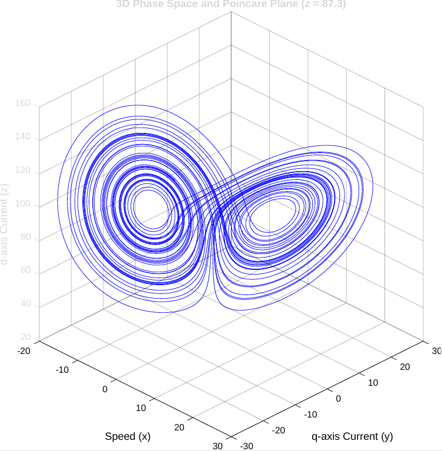
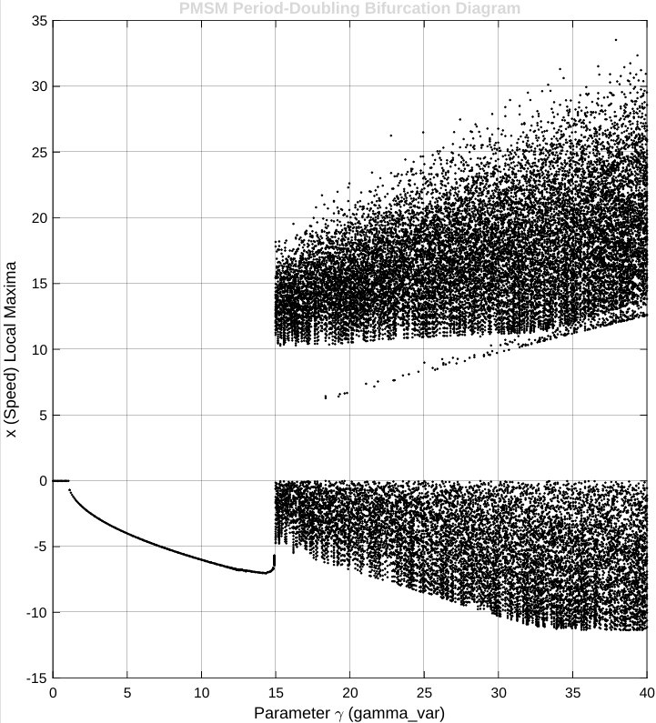
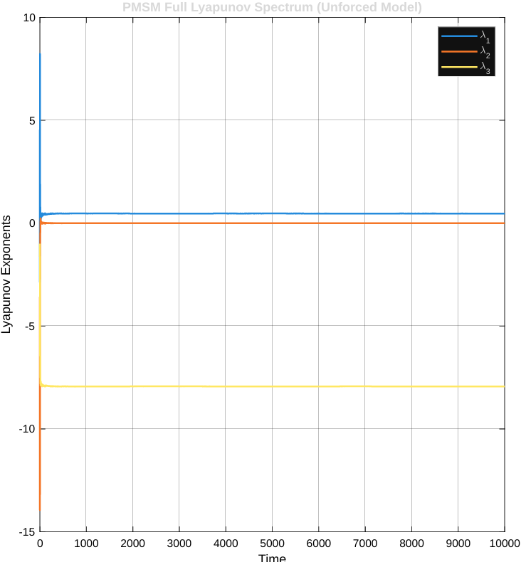
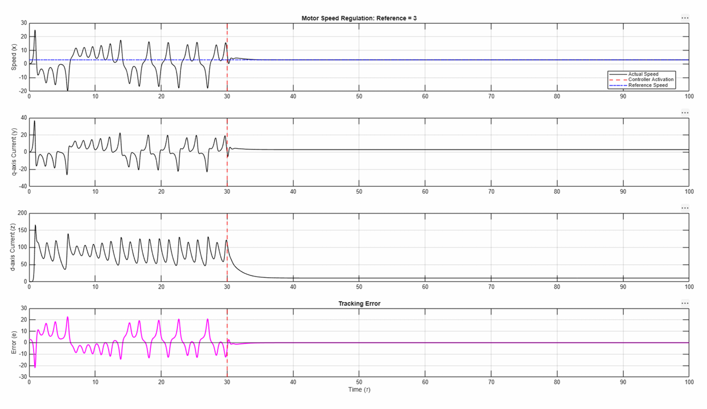

# Nonlinear Dynamical Analysis and Chaos Control of a PMSM

[](https://www.mathworks.com/products/matlab.html)
[]()

## Overview
This repository presents a comprehensive analytical and numerical framework for investigating **deterministic chaos**, **bifurcation routes**, and **closed-loop control strategies** in a **Permanent Magnet Synchronous Motor (PMSM)**.

Unlike conventional studies that enforce artificial Lorenz symmetry ($D = 1/C$), this work derives an **autonomous, physics-preserving dimensionless model** that retains the true electromechanical asymmetry of the motor hardware. Two distinct control architectures are designed and verified:
1. **Master-Slave Chaotic Synchronization (PID Control):** Forces a slave PMSM to track the unpredictable chaotic trajectory of a master PMSM (applicable to secure communications and multi-motor coordination).
2. **Chaos Suppression & Speed Regulation (State-Feedback PI-D Control):** Eliminates chaotic oscillations and stabilizes the rotor at a target industrial speed ($x_{\text{ref}} = 3 \approx 2421\text{ RPM}$) without high-frequency derivative noise.

---

## Key Technical Highlights & Algorithms

* **Physics-Preserving Dimensionless Modeling:** Derived directly from 3-phase Kirchhoff's Voltage Law, Park Transformation ($abc \rightarrow dq$), and Newton's Second Law, introducing independent cross-coupling parameters ($C = 1.2$, $D \approx 0.2083$) mapped to real motor parameters ($u_d = -96.1\text{ V}$).
* **Stability & Dissipativity Proof:** Symbolic Jacobian linearization and eigenvalue evaluation across equilibrium points ($E_0, E_1, E_2$), alongside vector field divergence verification ($\nabla \cdot f = -(\sigma + 2) = -7.46 < 0$).
* **Poincaré Section via Dense-Output Event Detection:** Uses adaptive RK45 (`ode45`) root-finding (`Events`) with unidirectional crossing filtering (`direction = 1`) on the $z = 87.3$ hyperplane to avoid interpolation artifacts.
* **Parameter Continuation Bifurcation Analysis:** Sweeps the bifurcation parameter $\gamma \in [0, 40]$ across 500 steps using steady-state state continuation to capture pitchfork symmetry breaking, Hopf instability, and chaotic onset ($\gamma \approx 15$).
* **Full Lyapunov Spectrum (Benettin Algorithm):** Custom fixed-step **4th-Order Runge-Kutta (RK4)** integrator coupled with **QR orthonormalization** over $T = 10,000$ time units, avoiding adaptive solver history invalidation.
  * Computed Spectrum: $\lambda_1 > 0$ (Chaos), $\lambda_2 \approx 0$ (Flow direction), $\lambda_3 < 0$ (Dissipation), satisfying $\sum \lambda_i \approx -7.46$.
* **Closed-Loop Control & Lyapunov Stability:**
  * **Master-Slave PID:** Linearized error dynamics verified via Routh-Hurwitz criterion and quadratic Lyapunov function ($A^T P + P A = -Q$).
  * **PI-D Speed Controller:** Uses direct $q$-axis current feedback ($-K_d y$) as an electronic damper instead of error differentiation to prevent noise amplification.

---

## Visual Results

| 3D Strange Attractor & Poincaré Plane | Bifurcation Diagram ($x$ Speed) |
| :---: | :---: |
|  |  |
| **Full Lyapunov Exponent Spectrum** | **PI-D Chaos Suppression ($t \ge 30$)** |
|  |  |

*(Note: Full mathematical derivations, physical parameter mappings, and 18 high-resolution figures are available in [`docs/PMSM_Chaos_Analysis_Report.pdf`](docs/PMSM_Chaos_Analysis_Report.pdf).)*

---

## Repository Structure

```text
├── docs/
│   └── PMSM_Chaos_Analysis_Report.pdf   # Detailed 66-page technical report & proofs
├── figures/                             # Generated simulation plots
└── matlab/
    ├── main_simulation.m                # Main execution script
    └── functions/
        ├── pmsm_dynamics.m              # Dimensionless 3-state ODE system
        ├── poincare_event.m             # Zero-crossing event function for Poincaré map
        ├── extended_pmsm.m              # Tangent-space variational ODEs for Lyapunov spectrum
        ├── pmsm_pid_sync.m              # Master-Slave PID synchronization dynamics
        └── pmsm_target_control.m        # State-feedback PI-D speed regulation controller# Nonlinear Dynamical Analysis and Chaos Control of a PMSM

[](https://www.mathworks.com/products/matlab.html)
[]()

## Overview
This repository presents a comprehensive analytical and numerical framework for investigating **deterministic chaos**, **bifurcation routes**, and **closed-loop control strategies** in a **Permanent Magnet Synchronous Motor (PMSM)**.

Unlike conventional studies that enforce artificial Lorenz symmetry ($D = 1/C$), this work derives an **autonomous, physics-preserving dimensionless model** that retains the true electromechanical asymmetry of the motor hardware. Two distinct control architectures are designed and verified:
1. **Master-Slave Chaotic Synchronization (PID Control):** Forces a slave PMSM to track the unpredictable chaotic trajectory of a master PMSM (applicable to secure communications and multi-motor coordination).
2. **Chaos Suppression & Speed Regulation (State-Feedback PI-D Control):** Eliminates chaotic oscillations and stabilizes the rotor at a target industrial speed ($x_{\text{ref}} = 3 \approx 2421\text{ RPM}$) without high-frequency derivative noise.

---

## Key Technical Highlights & Algorithms

* **Physics-Preserving Dimensionless Modeling:** Derived directly from 3-phase Kirchhoff's Voltage Law, Park Transformation ($abc \rightarrow dq$), and Newton's Second Law, introducing independent cross-coupling parameters ($C = 1.2$, $D \approx 0.2083$) mapped to real motor parameters ($u_d = -96.1\text{ V}$).
* **Stability & Dissipativity Proof:** Symbolic Jacobian linearization and eigenvalue evaluation across equilibrium points ($E_0, E_1, E_2$), alongside vector field divergence verification ($\nabla \cdot f = -(\sigma + 2) = -7.46 < 0$).
* **Poincaré Section via Dense-Output Event Detection:** Uses adaptive RK45 (`ode45`) root-finding (`Events`) with unidirectional crossing filtering (`direction = 1`) on the $z = 87.3$ hyperplane to avoid interpolation artifacts.
* **Parameter Continuation Bifurcation Analysis:** Sweeps the bifurcation parameter $\gamma \in [0, 40]$ across 500 steps using steady-state state continuation to capture pitchfork symmetry breaking, Hopf instability, and chaotic onset ($\gamma \approx 15$).
* **Full Lyapunov Spectrum (Benettin Algorithm):** Custom fixed-step **4th-Order Runge-Kutta (RK4)** integrator coupled with **QR orthonormalization** over $T = 10,000$ time units, avoiding adaptive solver history invalidation.
  * Computed Spectrum: $\lambda_1 > 0$ (Chaos), $\lambda_2 \approx 0$ (Flow direction), $\lambda_3 < 0$ (Dissipation), satisfying $\sum \lambda_i \approx -7.46$.
* **Closed-Loop Control & Lyapunov Stability:**
  * **Master-Slave PID:** Linearized error dynamics verified via Routh-Hurwitz criterion and quadratic Lyapunov function ($A^T P + P A = -Q$).
  * **PI-D Speed Controller:** Uses direct $q$-axis current feedback ($-K_d y$) as an electronic damper instead of error differentiation to prevent noise amplification.

---

## Visual Results

| 3D Strange Attractor & Poincaré Plane | Bifurcation Diagram ($x$ Speed) |
| :---: | :---: |
|  |  |
| **Full Lyapunov Exponent Spectrum** | **PI-D Chaos Suppression ($t \ge 30$)** |
|  |  |

*(Note: Full mathematical derivations, physical parameter mappings, and 18 high-resolution figures are available in [`docs/PMSM_Chaos_Analysis_Report.pdf`](docs/PMSM_Chaos_Analysis_Report.pdf).)*

---

## Repository Structure

```text
├── docs/
│   └── PMSM_Chaos_Analysis_Report.pdf   # Detailed 66-page technical report & proofs
├── figures/                             # Generated simulation plots
└── matlab/
    ├── main_simulation.m                # Main execution script
    └── functions/
        ├── pmsm_dynamics.m              # Dimensionless 3-state ODE system
        ├── poincare_event.m             # Zero-crossing event function for Poincaré map
        ├── extended_pmsm.m              # Tangent-space variational ODEs for Lyapunov spectrum
        ├── pmsm_pid_sync.m              # Master-Slave PID synchronization dynamics
        └── pmsm_target_control.m        # State-feedback PI-D speed regulation controller
